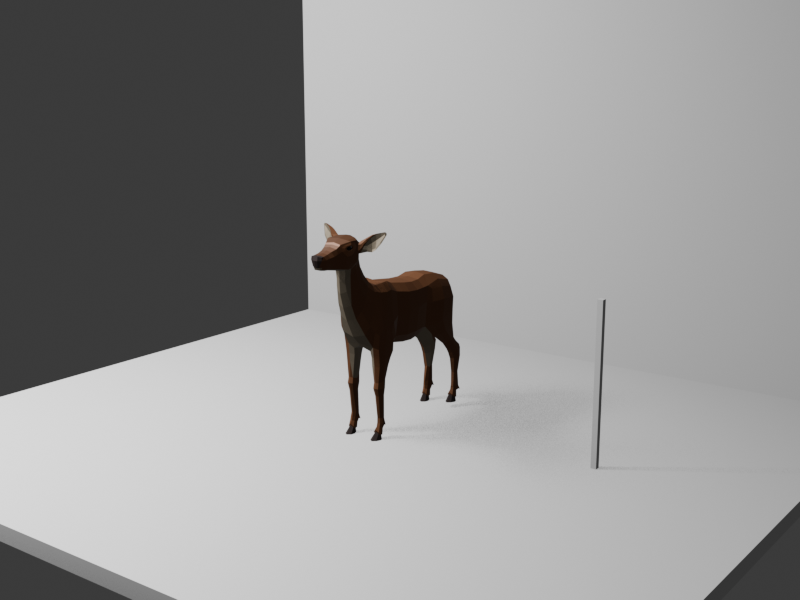

# Quaternius deer animation and floor review — 2026-10-21

Source: `art-incoming/nidal-hall-animals/quaternius-deer.glb`. I imported it into local Blender 5.2.2 and used `deer_animation_preview.py` to isolate `Idle`, mute the other imported NLA tracks, retain the earlier trial scale `0.3149539229`, and place a fixed floor at the evaluated lowest vertex of frame 0. This is an offline preview; the asset is still in `art-incoming/`.

## Available clips

The import exposes 13 armature clips, plus 13 paired actions without the `AnimalArmature|` prefix. Frame ranges at Blender's 24 fps:

| Clip | Frames | Approximate duration |
| --- | ---: | ---: |
| `Idle`, `Idle_2`, `Idle_Headlow` | 0–80 | 3.33 s |
| `Idle_HitReact_Left` | 0–11 | 0.46 s |
| `Idle_HitReact_Right`, `Gallop` | 0–12 | 0.50 s |
| `Walk` | 0–28 | 1.17 s |
| `Gallop_Jump` | 0–33 | 1.38 s |
| `Jump_toIdle` | 0–36 | 1.50 s |
| `Eating` | 0–144 | 6.00 s |
| `Death` | 0–20 | 0.83 s |
| `Attack_Headbutt`, `Attack_Kick` | 0–19 | 0.79 s |

These durations are Blender frame-range calculations, not a browser `AnimationClip.duration` measurement.

## Isolated `Idle` contact

At frames 0, 20, 40, 60, and 80, the evaluated mesh minimum remains exactly at floor Z=0 after one fixed `+0.00413 m` root offset. The nearest rear-leg vertices are approximately `0.00133 m` above the floor. One front-leg region remains about `0.03585 m` up in every sample; the still shows the small raised hoof. Those regions are selected by vertex X/Y bands, so they approximate individual hoof contact rather than bone-specific measurements. The sampled minimum never penetrates the floor. The root and armature world translations remain `(0, 0, 0.00413)` throughout these frames: no measured root translation. The head/torso moves, with evaluated top height ranging `1.34243–1.35894 m` across the sampled frames. Frame 80 returns to frame 0 bounds.

`Idle` is a plausible stationary preview clip: one hoof planted, rear hooves within roughly 1.3 mm of the floor, and no root drift in the sampled poses. It is **not** a four-hoof planted pose. The earlier default-pose calibration reached 1.65 m; this animated idle stands roughly 1.35 m at the same scale, so the trial scale needs in-game visual comparison before any promotion. `Idle_2`, `Idle_Headlow`, transitions, and movement clips have not been contact-checked. This offline render does not establish Hall placement, game Y-up conversion, collision, browser skinning, draw cost, or FPS.
