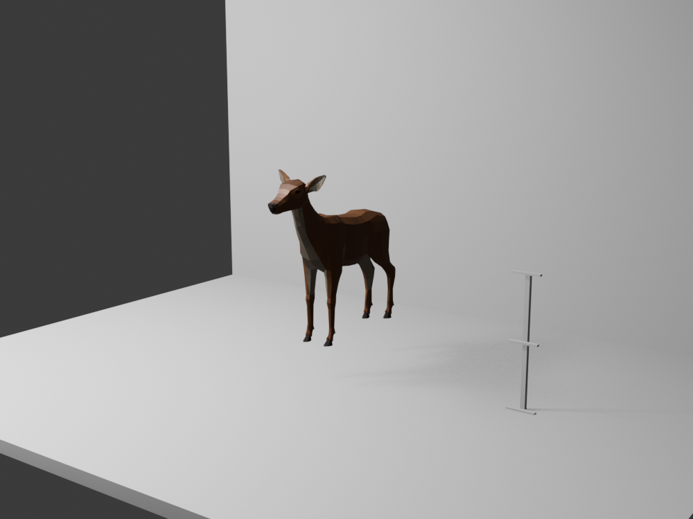

# Deer calibration — isolated offline preview, 2026-10-21

Source: `art-incoming/nidal-hall-animals/quaternius-deer.glb` (Quaternius, CC0; source and checksum documented in `art-incoming/nidal-hall-animals/SOURCE-quaternius-deer.md`). This is an incoming review asset. Nothing was copied to `public/` or changed in the runtime Hall.

`deer_calibration_preview.py` imports the GLB in Blender 5.2.2, evaluates all skinned mesh vertices in its default imported pose, uniformly scales the model, places its lowest evaluated vertex at a flat floor, and renders one 1000 × 750 still beside a 1 m ruler. Reproduce with Blender in background mode using the script in this directory. The neutral wall/floor is a Hall-like scale context, not game geometry.

| Measurement | Evaluated result |
| --- | --- |
| Imported bounds, Blender X/Y/Z metres | min `(-0.9511, -2.8304, -1.0000)`, max `(0.9511, 1.6677, 4.2389)` |
| Axes | Imported glTF converted by Blender to Z-up; Blender X/Y ground plane. Game uses Y-up and would require its own GLTFLoader bounds. |
| Preview scale | Uniform `0.3149539229`, chosen for a tentative 1.65 m full visible height. This is a visual trial, not approved world scale. |
| Placed evaluated bounds | min `(-0.2995, -0.8915, 0.0000)`, max `(0.2995, 0.5252, 1.6500)` m. Width 0.5991 m, depth 1.4167 m. |
| Contact | Lowest visible hoof rests at floor Z=0 in this default pose. Other hooves appear slightly raised; a walking/idle clip or game animation may move them. No animation clip was played. |

The still confirms a legible low-poly silhouette and one-point hoof contact at this preview scale. Its flat wall and lighting do not establish fit with Hall decor. It does not verify browser rendering, placement in the actual scene, animation, collision, draw cost or FPS. Inspect the GLTFLoader skinned bounds and a chosen animation frame before any runtime integration.
